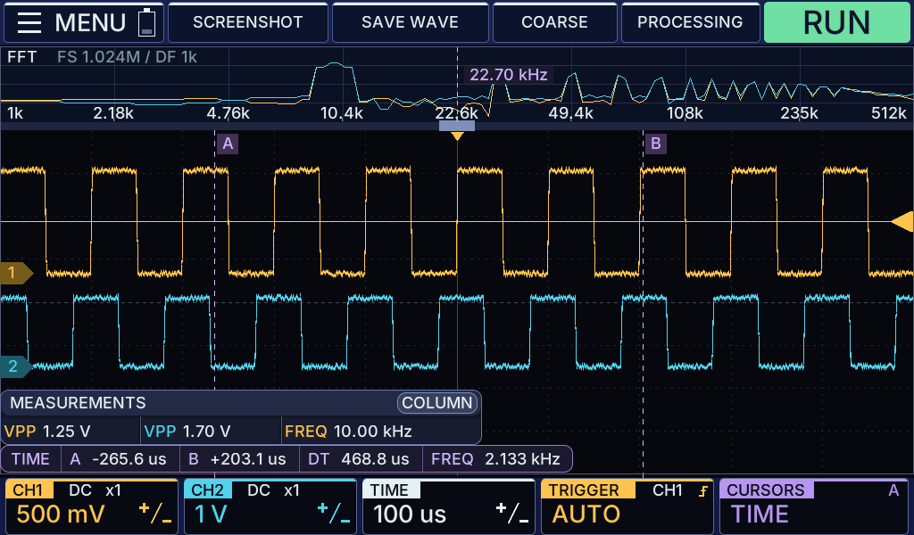

# ZYNQ7020 — экран и основное приложение осциллографа

Проект для Zynq-7020: аппаратная часть FPGA, Linux и приложение на C. Выводит интерфейс 1024 × 600 через HDMI, обрабатывает USB-сенсор и панель STM32 через USB–UART. Штатная сборка получает данные АЦП; DEBUG → SIMULATION подставляет демосигнал после захвата. Настройка и проверка — [захват АЦП](../docs/ADC_CAPTURE.md).

## Что хранится

- `gui/` — приложение и настольный предпросмотр для Windows и Linux.
- `fpga/` — исходники и настройки Vivado.
- `standalone/` — тест платы и настройка видео для загрузчика FSBL.
- `linux/` — настройки Linux и скрипты сборки прошивки.
- `output/` — готовые прошивки и журналы сборки.

## Как собрать прошивку

Один раз выполнить [подготовку окружения](../docs/agents/BUILD.md#подготовка-полной-сборки-zynq).

1. Закрыть Vivado/SDK с этим проектом и открыть PowerShell в корне репозитория `Oscill`.
2. Запустить `./ZYNQ7020/linux/build.ps1` и дождаться `Ready`.
3. Забрать `BOOT.BIN`, `image.bin`, `qspi.bin` и `fsbl.elf` для SDK Program Flash из `ZYNQ7020/output/linux/`.

Запись на плату — [FLASHING.md](../docs/agents/FLASHING.md#zynq-7020), запуск Windows-предпросмотра — [документация GUI](gui/README.md).
